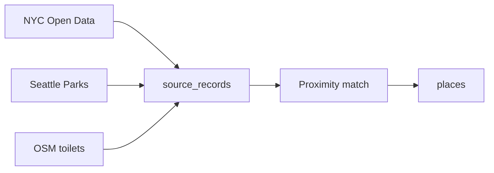

# Bathroom data pipeline

Living notes for how bathroom records get into the database. Water fountains are a later step and are not loaded yet.

The first run is local SQLite only. Railway is the same command later, after the local counts look right, and only with `--allow-remote`.

## Status

- Backend virtualenv is Python 3.11.8 (`backend/.venv`). The old 3.8 env could not install the pinned requirements.
- Local SQLite is `backend/instance/app.db` (gitignored). `DATABASE_URL` is unset, so nothing was written to Railway.
- Migrations applied: users `677927e18136`, bathrooms `c4a8e1b09f27`.
- `init` and `update` both completed against that SQLite file. `update` changed no rows and kept the same place ids. See [Local test](#local-test).
- The Google Sheet of source notes is private (HTTP 403). Columns below come from the public datasets, not that sheet.

## What gets stored

Two tables, no city column. Latitude and longitude are the location. NYC and Seattle are only `--region` choices for which feed to call.

`source_records` is one upstream row. The upsert key is `(source, external_id)`.

- `source`: `nyc_opendata`, `seattle_parks`, or `osm`
- `external_id`: NYC is a hash of facility name, location type, and coordinates rounded to 5 decimals. Seattle is `GLOBALID` (then `LOCATION_ID`, `PMAID`, or `OBJECTID`). OSM is `node/123`, `way/123`, or `relation/123`.
- `kind`: `bathroom` for now. `fountain` is reserved and unused.
- `place_id` and `match_distance_m`. Distance is null on the row that owns the place.
- Typed fields: name, latitude, longitude, hours, notes, status, seasonal, wheelchair, operator, location_type, changing_table, fee, website, restroom_type
- `raw` JSON of the original payload
- `active`, `fetched_at`

`places` is the merged row to display.

- `owner_key` is the stable id, `{source}:{external_id}` of the winning source row
- `display_name`, latitude, longitude
- hours, notes, status, seasonal, wheelchair, operator, location_type
- changing_table, fee, website, restroom_type when any source has them
- `primary_source`, `active`, timestamps

Status is normalized to `open`, `closed`, `limited`, or `unknown`. Hours stay a string (`7AM - 7PM`, `Year Round` is seasonal, OSM `opening_hours` stays as written).



## Sources

- NYC: [Public Restrooms](https://data.cityofnewyork.us/City-Government/Public-Restrooms/i7jb-7jku), SODA `https://data.cityofnewyork.us/resource/i7jb-7jku.json`. Uses facility name, location type, operator, status, open (season), hours, accessibility, restroom type, changing stations, additional notes, website, latitude, longitude.
- Seattle: [Park Restrooms](https://services.arcgis.com/ZOyb2t4B0UYuYNYH/arcgis/rest/services/Parks_Restrooms/FeatureServer/0) GeoJSON. Parks only. Uses facility name or park name, description, open-to-public, current status, reason closed, season, hours, and point geometry.
- OSM, both regions: Overpass `amenity=toilets` around the city window, widened so it also covers city-data points. Tags: `name`, `opening_hours`, `note` / `description`, `wheelchair`, `operator`, `fee`, `changing_table`, `access`, lat/lon (way and relation centroid). `access=private` and `access=no` are stored inactive.

## Merge rules

City open data always wins over OSM.

- Every active city row owns a place. The place coordinates are the city coordinates, never the OSM point and never an average.
- For every other field, a non-empty city value is copied. OSM fills a field only when the city value is blank.
- An active OSM row within 30 meters of a city row attaches to the nearest city place and does not get its own active place.
- An OSM row with no city neighbor becomes its own place. The name falls back to `Public restroom`.
- A source row missing from the latest pull is marked inactive. Its place is deactivated only when that row was the owner. An attached OSM row disappearing does not drop the city place.
- Matching uses distance only. Region is not a column and not a join key.

## Commands

From `backend`, with the virtualenv active and `DATABASE_URL` empty:

```bash
flask db upgrade
python -m app.ingest init
python -m app.ingest update
```

- `init` refuses to run if bathroom rows already exist. `init --force` wipes bathroom rows and loads again.
- `update` fetches, upserts, deactivates missing ids, and rematches. It is safe to rerun.
- `--region nyc|seattle|all` chooses which feeds run. Default is `all`.
- The script prints the database it is about to write. A Postgres URL, including Railway, is refused unless `--allow-remote` is passed.
- Ingest does not run from `entrypoint.sh`. Deploys only run `flask db upgrade`.

City feeds are entries in `REGIONS` inside [backend/app/ingest/sources.py](../backend/app/ingest/sources.py). Each entry names the query type (`soda` or `arcgis`), the URL, the column mapping, and how to build an id. One function, `fetch_open_data`, loads whichever entry you pass. OpenStreetMap is the same Overpass query for every region; the entry only supplies `osm_bbox`. Adding a city means adding a `REGIONS` entry, not a new script.

The ingest package is three files:

- `sources.py`: the `REGIONS` config, HTTP calls, and turning each feed into the shared record shape
- `pipeline.py`: upserting `source_records`, matching OSM to city rows, and rebuilding `places`
- `__main__.py`: the `init` and `update` command

Models are `backend/app/models/place.py`. Migration `c4a8e1b09f27` creates the tables.

## Local database

Leave `DATABASE_URL` blank. The app uses SQLite at `backend/instance/app.db`, which is gitignored. Create the virtualenv with Python 3.11, the same version as the backend Docker image:

```bash
cd backend
python3.11 -m venv .venv
source .venv/bin/activate
pip install -r requirements.txt
```

`python` on this machine is Anaconda 3.8. `python3.11` is the interpreter that can install the requirements.

## Water fountains later

Not fetched. `kind` is already on both tables. A later step can add Overpass `amenity=drinking_water` and any NYC or Seattle fountain dataset, reusing init/update and the same common columns.

## Out of scope

App or API routes, map UI, PostGIS, parsed weekly hours, a scheduled Railway job, and writing to the Railway database.

## Local test

Ran on 12 Nov 2026 from `backend` with `DATABASE_URL` unset.

`python -m app.ingest init` loaded:

- NYC Open Data: 1,100 rows (the live dataset count, none skipped)
- Seattle Parks: 157 rows. 152 active places. 5 source rows stayed inactive because the layer marks them demolition-pending (`DP`) or decommissioned (`DE`); they are not display places.
- OSM: 951 rows around NYC and 280 around Seattle. 1,222 active. 9 inactive because `access` is `private` or `no`.
- 629 OSM rows attached to a city place within 30 meters. 593 OSM rows became their own places.
- Active places: 1,100 from NYC, 152 from Seattle Parks, 593 from OSM.

`python -m app.ingest update` fetched the same totals. A hash of place ids, coordinates, names, and source fields matched the init snapshot, so the second run did not insert or rewrite rows.

On 14 Nov 2026, after the ingest code was reorganized into `sources.py`, `pipeline.py`, and `__main__.py`, `update` left the database byte-for-byte identical to the snapshot taken before it ran. `init --force` rebuilt the same places, fields, and source-to-place links (new row ids, same content).

Checks on the merged rows:

- For every OSM row attached to a city place, the place coordinates equal the city coordinates. Where the points are not identical, the place does not use the OSM point. Example: Orchard Beach Pavilion stays at the NYC point `40.86627, -73.7947`, about 30 meters from the OSM node, with NYC hours `8am-4pm, Open later seasonally`.
- When both the city row and the OSM row have hours, the place keeps the city hours. OSM hours filled the place only when the city hours were blank (5 places).
- Sample NYC place: Brooklyn Central Library, BPL, open, wheelchair `yes`, operator BPL, with weekday hours.
- Sample Seattle place: Green Lake Pk Bathhouse Theater, `47.68212, -122.33981`, hours `7AM - 7/9PM`, status open, season `YEAR ROUND`.
- Sample OSM-only place: Court 7 at `40.74882, -73.84701`.
